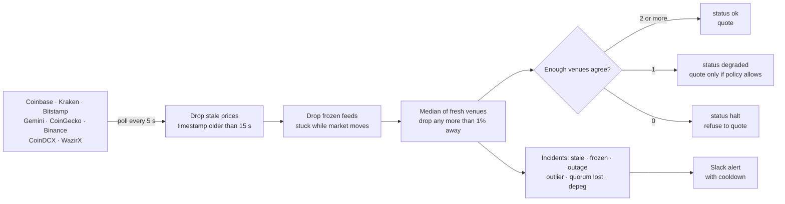

# TickTrust


**Crypto reference prices you can safely quote a customer on, with alerts the moment a price feed goes wrong.**

A crypto payment gateway, exchange or fintech app shows a price, and a customer pays at that price. If that number comes from one API, a single bad feed becomes a loss: a stale price during a fast market, a venue flash crash, a units error, a frozen ticker, a stablecoin that quietly loses its peg. TickTrust combines several public venues into one reference price, drops feeds it cannot trust, **refuses to quote when it cannot be sure**, and tells your team on Slack what broke.

## Results

`python -m ticktrust.evaluate` simulates 4 hours of BTC, ETH and USDT markets with five venues and injected feed faults, and asks each strategy for a price every second (43,200 quotes per set). The **held-out** set uses different noise, latency, fault sizes and *combined* faults (two venues failing together, a real 6% crash while one feed is frozen and another drifts, a 3% stablecoin depeg). It was written before TickTrust ever ran on it and never used for tuning. CI fails on a single bad quote, missed fault or false alert.

| Strategy | Bad quotes (dev) | Bad quotes (held-out) | Loss on bad quotes, both sets | Worst error dev / held-out |
|---|---|---|---|---|
| Single API (what this repo used to do) | 409 | 2,870 | $48,881 | 900% / 99,937% |
| Average of 5 venues (typical dashboard) | 306 | 1,746 | $27,360 | 180% / 19,987% |
| **TickTrust** | **0** | **0** | **$0** | **0.14% / 0.47%** |

A bad quote is more than 0.5% from the true price; each quote is a $1,000 invoice and its loss is capped at the invoice value. TickTrust stayed 100% available: it never had to refuse a quote in either set.

| Feed fault injected | Detected (dev) | Detected (held-out) |
|---|---|---|
| Stale price (old timestamp) | 6/6 | 4/4 |
| Frozen price (fresh timestamp, stuck value) | 4/4 | 2/2 |
| Venue flash crash or spike | 6/6 | 9/9 |
| Units error (×0.1, ×10, ×1000) | 6/6 | 3/3 |
| Venue outage | 6/6 | 6/6 |
| Slow drift away from the market | 2/2 | 2/2 |
| Stablecoin depeg | 1/1 | 1/1 |

**58 of 58 faults detected, 0 false alerts, median 13 to 14 seconds to detect.** The engine handles over 50,000 price rounds per second on one CPU core.

## Who buys it and how it is sold

| | |
|---|---|
| **Buyers** | Crypto payment gateways and merchant checkouts; exchanges and brokers that need an index price; fintech and wallet apps showing INR prices; OTC desks and treasury teams |
| **Their pain** | Quoting from one feed means every venue glitch is a mispriced invoice, a bad liquidation or an angry customer, and nobody notices until the money is gone |
| **What they get** | One API call that returns a price *and* whether it is safe to use, a quote with an audit trail, and Slack alerts for stale, frozen, broken and depegged feeds |
| **Deployment** | Docker on their own cloud; one service, no database needed. Runs from public venue APIs, or from their licensed market-data feeds |
| **India ready** | INR pairs from CoinDCX, WazirX and CoinGecko next to the global USD venues |

**ROI from the benchmark above:** a gateway pricing one $1,000 invoice per second on three pairs would have lost **$48,881 in 8 hours** with a single API and **$27,360** with a simple average. TickTrust lost nothing and caught every fault. Real exposure depends on volume, but a single prevented incident usually covers a year of the service.

| Plan (suggested) | For | Price idea |
|---|---|---|
| Starter | Small merchants, early fintechs | Monthly fee for up to 10 pairs, Slack alerts |
| Business | Payment gateways, apps | Higher monthly fee: unlimited pairs, quote audit trail, custom policy |
| Enterprise | Exchanges, brokers | Annual licence, on-premise, licensed data feeds, SLA and incident reports |

**Pilot plan (30 days):** run TickTrust in *shadow mode* next to the client's current price source. Every quote they issue is compared with TickTrust's price and status. At the end they get a report: how many of their quotes were outside 0.5%, which feed incidents they missed, and what those quotes were worth. No change to their checkout until they decide.

## How it works



| Design choice | Why |
|---|---|
| Median, not average | One venue printing ×1000 moves an average by 20,000%; it cannot move a median |
| Venue timestamps, not fetch time | A venue can answer quickly with an old price; age is judged from the venue's own clock where it provides one |
| Frozen check needs the market to move | A flat price in a flat market is normal; flat while others moved 0.1% is a stuck feed |
| Two venues that disagree = no price | With nobody to break the tie, guessing is worse than refusing |
| Refusing is a feature | A `503` with a reason costs one retry; a wrong price costs money |
| Depeg is an alert, not a filter | When every venue agrees USDT is at 0.97, that *is* the price; the team must know, not have it hidden |
| Policy in YAML | Thresholds are a business decision for the payments or risk team, not a code change |

## Use it

```bash
docker compose up -d                               # API :8000 + dashboard :8501, live prices
TICKTRUST_MODE=replay docker compose up -d         # offline demo on the benchmark market
```

```bash
pip install -e ".[api,app]"
ticktrust live --watch 5                           # live table + incidents in the terminal
streamlit run app.py                               # dashboard: replay or live
python -m ticktrust.evaluate --gate                # benchmark
```

| Endpoint | What it does |
|---|---|
| `GET /v1/prices/{pair}` | Reference price, low/high across venues, status, venues used and dropped with reasons |
| `POST /v1/quote` | `{"pair": "BTC-INR", "fiat_amount": 5000}` → crypto amount, price, expiry, quote id; `503` with the reason when not safe |
| `GET /v1/quotes/{id}` | The exact price and venues behind a past quote (audit trail) |
| `GET /v1/incidents` | Open incidents, or recent history with `?open_only=false` |
| `GET /health` | Pairs, last polling round, open incidents |

```bash
curl -X POST localhost:8000/v1/quote -H 'X-API-Key: change-me' -H 'Content-Type: application/json' \
  -d '{"pair":"BTC-USD","fiat_amount":1000}'
```

Pairs out of the box: BTC, ETH, SOL against USD; USDT and USDC against USD; BTC, ETH, USDT against INR (Binance USDT pairs are also mapped). Set `TICKTRUST_SLACK_WEBHOOK` for alerts and edit [`config/policy.example.yaml`](config/policy.example.yaml) for thresholds.

## Limitations

- The benchmark is synthetic: real incidents cannot be replayed with ground truth. The shadow-mode pilot is how a client validates it on real traffic.
- If a **majority** of venues are wrong in the same direction (3 of 5), the median follows them. More independent venues, or a licensed consolidated feed as one input, reduce that risk.
- Kraken and Binance ticker endpoints carry no price timestamp, so their age is the fetch time.
- Public endpoints have rate limits, and some venues restrict commercial redistribution of their data. Production use should run on the client's own exchange connections or licensed market data; TickTrust's logic is independent of the source.
- Not a trading tool and not investment advice. It answers one question: can this price be trusted right now?

## Project layout

```
src/ticktrust/engine.py    reference price: freshness, median, outliers, quorum
src/ticktrust/monitor.py   feed state, frozen detection, incidents, depeg
src/ticktrust/sources.py   public venue endpoints and parsers (no API keys)
src/ticktrust/alerts.py    Slack/webhook alerts with cooldown
src/ticktrust/service.py   live polling, offline replay, payment quotes with audit trail
src/ticktrust/api.py       FastAPI service
src/ticktrust/synth.py     simulated market with injected feed faults (dev + held-out)
src/ticktrust/evaluate.py  benchmark vs single API and simple average, CI gate
app.py                     Streamlit dashboard
config/                    risk policy
```
